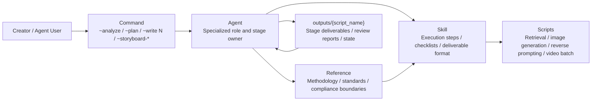
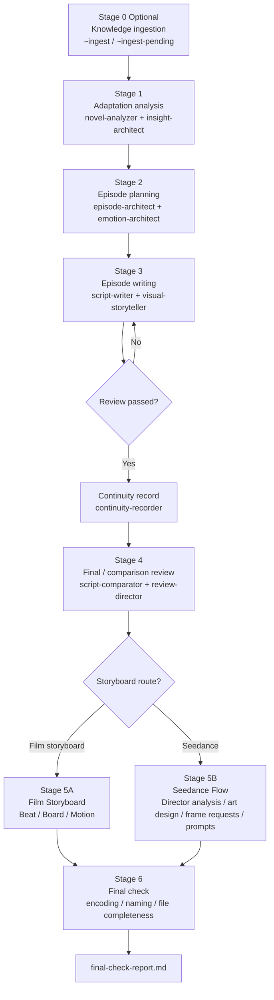

# Novel-to-Script-Team

> A multi-agent, multi-skill screen adaptation pipeline that turns novels, story outlines, or short-drama material into adaptation analysis, episode plans, scripts, review reports, storyboard plans, and image/video prompts.

[中文 README](README.md) | [Agent Guide](AGENTS.md) | [MIT License](LICENSE)

## What It Is

Novel-to-Script-Team is not a single prompt. It is a reusable production pipeline for narrative adaptation. It breaks novel-to-screen work into specialized roles and auditable stages: adaptation analysis, insight extraction, emotional and episode planning, script writing, review, continuity tracking, storyboard handoff, and video-prompt delivery.

Use it for:

- adapting novels into short dramas, web series, or webtoon-style scripts;
- turning original concepts into episode plans and sample episodes;
- reviewing scripts for style, pacing, compliance, visuality, and continuity;
- converting scripts into storyboards, Seedance/Sora/video prompts, and frame requests;
- building a repeatable agent workflow for creative teams.

## Core Capabilities

- **Structured adaptation, not one-shot prompting**: the workflow breaks adaptation into analysis, insight extraction, episode planning, emotional design, script writing, review, continuity tracking, and storyboard/video handoff; every stage has clear inputs, deliverables, owner agents, and revision paths.
- **From source text to video-ready assets**: the same pipeline can produce adaptation analysis, episode outlines, scripts, review reports, character/scene/prop prompts, storyboard plans, frame requests, and video prompts.
- **Adaptation analysis**: extracts genre, plotline, character relationships, world rules, core conflict, and filmability risks before deciding how the story should become screen material.
- **Insight and emotional design**: identifies visible narrative, hidden truth, emotional hooks, audience expectations, suspense chains, and cognitive-load strategy.
- **Episode planning and script writing**: creates episode outlines, cliffhangers, pacing, and short-drama/webtoon-style scripts; writing can retrieve local licensed hit-script references for pacing, hooks, payoff, and phrasing.
- **Visual rewrite**: dedicated Show Don't Tell checks convert abstract psychology into visible action, expressions, props, scenes, and camera language.
- **Layered review loop**: business review, compliance review, style analysis, one-by-one comparison, and final review happen throughout the process; failed checks route back to revision instead of becoming final-only advice.
- **Continuity tracking**: records character settings, forms of address, props, timeline, foreshadowing, and setting changes to reduce cross-episode drift.
- **Two storyboard/video routes**: supports a film-storyboard route and a Seedance/Sora/image-to-video prompt route.
- **Replaceable media providers**: image generation, reverse prompting, and SkyReels batch scripts configure API keys, base URLs, models, and endpoints through `.env` or process env.
- **Resumable multi-agent workspace**: `outputs/{script_name}/.agent-state.json` preserves project context for long-running adaptation work.

## Open-Source Notes

This repository provides the Agent/Skill workflow, core reference methodology, and utility scripts for novel adaptation, script review, storyboard planning, and video-prompt generation. Generated outputs are written locally under `outputs/{script_name}/`; image/video scripts require the relevant API keys, base URLs, and optional models in `.env` or process environment variables.

### Using Hit-Script Retrieval

The script-writing stage can use `hit-script-retrieval-skill` to retrieve reference samples from your own licensed script corpus. This helps the agent study pacing, hooks, emotional payoff, and phrasing. The repository does not include script corpus files; add your own authorized `.md` files here:

```bash
mkdir -p knowledge/hit-scripts-md
```

Recommended layout:

```text
knowledge/hit-scripts-md/
├── female-rebirth-revenge-001.md
├── female-wealthy-romance-001.md
├── male-warrior-return-001.md
└── suspense-supernatural-twist-001.md
```

Recommended file shape:

```markdown
# Title or Case Name

## Tags
female / rebirth / revenge / wealthy-family / romance

## Structure Notes
- Opening hook: ...
- Core conflict: ...
- Twist point: ...

## Script Body or Excerpt
...
```

After adding files, test retrieval manually:

```bash
python3 scripts/quick_search.py "rebirth revenge wealthy-family"
python3 scripts/improved_hybrid_search.py "rebirth revenge wealthy-family" female
```

Parameter notes:

- `quick_search.py`: lightweight keyword retrieval; no vector index required; useful for checking whether files are in the right place.
- `improved_hybrid_search.py`: hybrid retrieval using keywords, semantic features, and gender-frequency classification; the second argument can be `male`, `female`, or `all`.
- The first hybrid-search run creates a local `.search_index/`; later runs reuse that local index.

During the Agent workflow, `~write N` attempts to retrieve the Top 5 reference scripts first. If no corpus is available, it skips reference retrieval and continues with the base writing flow.

## Quick Start

### 1. Requirements

- Python 3.10+ (3.11 or 3.12 recommended)
- Git
- Optional: Claude Code, Codex, Cursor, or any agent environment that can read `AGENTS.md`

Install dependencies:

```bash
python3 -m venv .venv
source .venv/bin/activate
pip install -r requirements.txt
```

Configure APIs (only required for image/video scripts):

```bash
cp .env.example .env
# Edit .env and fill in the keys, base URLs, and optional models you need.
```

| Variable | Purpose | Required |
|----------|---------|----------|
| `NANO_BANANA_API_KEY` | Auth for image generation and reverse prompting | Required only by `scripts/generate_image.py` and `scripts/reverse_prompt.py` |
| `NANO_BANANA_BASE_URL` | OpenAI-compatible Base URL, e.g. `https://your-provider.example/v1` | Required for image generation / reverse prompting; no vendor URL is hardcoded |
| `NANO_BANANA_IMAGE_MODEL` | Image generation model | Optional; defaults to `gemini-3.1-flash-image-preview` |
| `NANO_BANANA_REVERSE_MODEL` | Image-to-prompt model | Optional; defaults to `gemini-3.1-pro-preview` |
| `SKYREELS_API_KEY` | Auth for SkyReels image-to-video jobs | Required only by `scripts/ava_skyreels_batch.py` |
| `SKYREELS_BASE_URL` | SkyReels API Base URL | Optional; defaults to the official gateway and can be overridden |
| `SKYREELS_SUBMIT_URL` / `SKYREELS_TASK_URL` | SkyReels submit/query endpoints | Optional; use for non-standard gateways |
| `TMPFILES_UPLOAD_URL` / `CATBOX_UPLOAD_URL` | Upload endpoints used before video batching | Optional; replace with your own upload service if needed |

### 2. Read the Agent Guide

```bash
cat AGENTS.md
```

`AGENTS.md` is the canonical platform-neutral guide. `CLAUDE.md` is kept only as a Claude Code compatibility adapter.

### 3. Typical Workflow

```bash
# Novel -> script
~ingest          # Optional: ingest local knowledge if sources/ or pending-knowledge/ exists
~analyze         # Adaptation analysis
~plan            # Episode planning
~write 1         # Write episode 1
~review 1        # Review episode 1

# Script -> storyboard (choose one)
~storyboard-film 1      # Film storyboard flow
~storyboard-seedance 1  # Seedance prompt flow

# Optional: image generation
~generate-images 1

# Final workflow check
~final-check
```

### 4. Validate Local Scripts

```bash
python3 -m py_compile scripts/*.py
python3 scripts/quick_search.py "rebirth revenge wealthy-family"
```

## How Agent / Skill / Reference Work Together



In short: **Agents decide who owns the work, Skills define how to execute it, References define quality standards, Scripts automate tool actions, and Outputs preserve project memory and deliverables.**

## Workflow Overview



## Two Storyboard Routes

### Film Storyboard Flow: `~storyboard-film N`

Best for traditional storyboards, image-to-video workflows, and storyboard-board delivery.

1. `storyboard-artist` creates Beat Breakdown.
2. `storyboard-artist` creates Beat Board.
3. `storyboard-artist` creates Sequence Board.
4. `animator` creates Motion Prompt.
5. `storyboard-director` reviews every step.

### Seedance Flow: `~storyboard-seedance N`

Best for prompt scripts that can be copied into Seedance-style video generation workflows.

1. `storyboard-director` creates director analysis: director notes, character list, scene list.
2. `art-designer` creates art-direction prompts for characters, scenes, and props.
3. `image-generator` optionally generates asset images.
4. `storyboard-artist` creates Seedance 2.0 prompts and frame-request lists.
5. `image-generator` generates first/last/reference frames when needed.
6. `storyboard-director` reviews mode selection, frame completeness, and prompt quality.

## Agent Architecture

| Agent | Responsibility | Main Dependencies |
|-------|----------------|-------------------|
| `knowledge-curator` | Ingest local material and update knowledge indexes | `knowledge-curation-skill` |
| `novel-analyzer` | Analyze source text for adaptation | `adaptation-analysis-skill` |
| `insight-architect` | Extract hidden truth, core conflict, and audience expectations | `references/18-theme-selection-philosophy.md` |
| `episode-architect` | Plan episodes, progress, hooks, and pacing | `episode-planning-skill` |
| `emotion-architect` | Design emotional curve, suspense, and expectation strategy | `references/14-story-psychology.md` |
| `script-writer` | Write episodes, analyze style, revise scripts | `script-writing-skill`, `hit-script-retrieval-skill`, `style-analysis-skill` |
| `visual-storyteller` | Improve visuality and Show Don't Tell execution | `show-dont-tell-skill` |
| `script-comparator` | Compare generated scripts against references | `one-by-one-comparison-skill` |
| `review-director` | Business, compliance, and final review | `script-review-skill`, `compliance-review-skill`, `comparative-review-skill` |
| `continuity-recorder` | Track characters, names, props, timeline, and foreshadowing | `continuity-record-skill` |
| `storyboard-director` | Direct storyboard analysis and review | `director-skill`, storyboard review skills |
| `storyboard-artist` | Create film storyboards and Seedance prompts | `film-storyboard-skill`, `seedance-storyboard-skill` |
| `storyboard-coach` | Provide storyboard coaching | `storyboard-coaching-skill` |
| `art-designer` | Design costume, props, color, lighting, and visual assets | `art-design-skill` |
| `animator` | Create motion, camera movement, transitions, and animation prompts | `animator-skill` |
| `image-generator` | Generate character, scene, prop, and frame images | `image-generation-skill` |
| `image-to-prompt` | Reverse images into visual descriptions and generation prompts | `image-to-prompt-skill` |

## Skill Groups

### Core Pipeline

- `knowledge-curation-skill`: ingests local material into stable project knowledge.
- `adaptation-analysis-skill`: analyzes source text, characters, conflicts, and filmability.
- `episode-planning-skill`: plans episode structure, hooks, and pacing.
- `script-writing-skill`: writes production-ready episode scripts.

### Script Quality and Review

- `script-review-skill`: business review for narrative quality, structure, and retention.
- `compliance-review-skill`: compliance review for content boundaries and copyright risk.
- `style-analysis-skill`: language-style analysis for sentence length, dialogue ratio, web-novel tone, and visual markers.
- `comparative-review-skill`: quick comparison review against references.
- `one-by-one-comparison-skill`: detailed one-by-one comparison for final review.
- `continuity-record-skill`: continuity memory for characters, names, props, and timeline.
- `show-dont-tell-skill`: converts abstract emotion into visible action.

### Storyboard and Video Handoff

- `storyboard-handoff-skill`: rules for moving from script to storyboard.
- `director-skill`: director analysis, character list, and scene list.
- `film-storyboard-skill`: film storyboard outputs using Beat/Sequence/Motion structures.
- `seedance-storyboard-skill`: Seedance prompt script and frame requests.
- `animator-skill`: motion, camera movement, transitions, and dynamic prompts.
- `art-design-skill`: character, scene, prop, color, and lighting design.

### Storyboard Review

- `script-analysis-review-skill`: reviews director analysis.
- `art-direction-review-skill`: reviews art direction.
- `seedance-prompt-review-skill`: reviews Seedance prompts.
- `storyboard-review-skill`: reviews storyboard structure.
- `storyboard-coaching-skill`: storyboard coaching.

### Retrieval and Media Tools

- `hit-script-retrieval-skill`: retrieves reference scripts from your own licensed local corpus.
- `image-generation-skill`: image and frame generation.
- `image-to-prompt-skill`: image-to-prompt reverse prompting.

## Reference Methodology

`references/` is the stable knowledge layer agents should read first:

- **A-level core standards**: `00-06`, `18` for first principles, adaptation, episode architecture, script standards, review gates, compliance boundaries, and theme selection.
- **B-level storyboard/video knowledge**: `08-12`, `19`, `20` for cinematography, storyboard methodology, scene design, video prompts, genre techniques, and frame description elements.
- **C-level knowledge management**: `07` for ingesting local material and turning it into reusable public conclusions.
- **D-level visual narrative and psychology**: `13-17` for Show Don't Tell, story psychology, color psychology, dramatic principles, and lighting narrative.
- **Execution standard**: `21-agent-logging-standard.md` for logging and deliverable indexing.

## Key Collaboration Patterns

1. **`insight-architect` -> `episode-architect` / `script-writer` / `emotion-architect`**
   - Insight reports define visible narrative, hidden truth, core conflict, and audience expectations.
2. **`emotion-architect` -> `script-writer`**
   - Emotional strategy defines episode goals, suspense chains, and cognitive-load guidance.
3. **`visual-storyteller` -> `script-writer`**
   - Visual review turns abstract psychology into actions, props, scenes, and shots.
4. **`script-comparator` -> `review-director`**
   - One-by-one comparison helps final review judge pacing, hooks, and emotional payoff.
5. **`continuity-recorder` -> all agents**
   - Project memory keeps characters, names, props, foreshadowing, and timelines consistent.
6. **`storyboard-director` -> `storyboard-artist` / `art-designer` / `animator`**
   - Director perspective aligns storyboard, art direction, motion prompts, and platform constraints.

## Core Mechanisms

### Resumable Subagents

Each project can maintain independent agent state:

- Script-level state file: `outputs/{script_name}/.agent-state.json`
- Same episode: resume the same agent where possible.
- Cross episode: reset agent IDs to avoid context-window overflow and stale context.
- Parallel projects: each output directory remains independent.

See `AGENT-STATE-GUIDE.md`.

### Dual Review

Every key stage uses:

1. Business review: narrative quality, structure, hooks, retention, emotional payoff.
2. Compliance review: content boundaries, platform risk, copyright risk, vulgarity, gore, minors, and related concerns.

Review loop:

```text
Generate -> Review -> Revise -> Re-review -> PASS
```

### Final Check

At the end of a full workflow:

1. UTF-8 encoding check.
2. Naming/form-of-address consistency check.
3. Required-file completeness check.
4. Write `outputs/{script_name}/final-check-report.md`.

## Directory Layout

```text
novel-to-script-team/
├── AGENTS.md                    # General agent workflow guide
├── CLAUDE.md                    # Claude Code compatibility adapter
├── SKILL.md                     # Project skill metadata
├── README.md                    # Chinese README
├── README_en.md                 # English README
├── AGENT-STATE-GUIDE.md         # Resumable Subagents guide
├── agents/                      # Agent role definitions
├── skills/                      # Skill execution rules
├── references/                  # Core methodology
├── knowledge/                   # Knowledge indexes, licensed corpus, and ingestion records
├── scripts/                     # Utility scripts
└── outputs/                     # Local generated outputs
```

Local output example:

```text
outputs/{script_name}/
├── .agent-state.json
├── analysis/
├── planning/
├── emotion-design/
├── scripts/
├── review/
├── storyboard/
├── assets/
├── images/
└── final-check-report.md
```

## Utility Scripts

| Script | Purpose |
|--------|---------|
| `scripts/quick_search.py` | Minimal keyword retrieval with no external dependency |
| `scripts/improved_hybrid_search.py` | Hybrid semantic + keyword + gender-frequency retrieval |
| `scripts/test_retrieval.py` | Retrieval system smoke test |
| `scripts/generate_image.py` | Batch image/frame generation |
| `scripts/reverse_prompt.py` | Image-to-prompt reverse prompting |
| `scripts/ava_skyreels_batch.py` | SkyReels image-to-video batch jobs |
| `scripts/ave_still_batch.py` | Batch still-image helper |
| `scripts/ave_composite_batch.py` | Batch compositing helper |
| `scripts/refresh_knowledge_registry.sh` | Refreshes knowledge registry indexes |

## License

This project is licensed under the MIT License. See [`LICENSE`](LICENSE).
